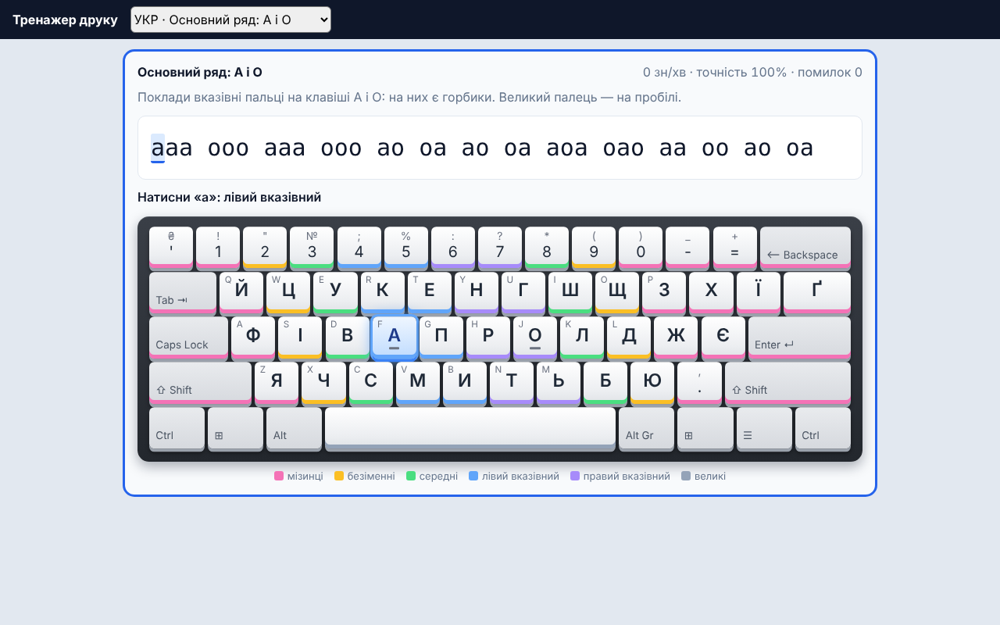

<h1 align="center">edu-typing</h1>

<p align="center">
  <b>An embeddable touch-typing trainer for kids and adults.</b><br>
  Ukrainian ЙЦУКЕН and English QWERTY layouts, finger hints on an on-screen keyboard, and a gradable result at the end of every exercise.
</p>

<p align="center">
  <a href="https://github.com/zavada123/edu-typing/actions/workflows/pages.yml"></a>
  <a href="https://zavada123.github.io/edu-typing/"></a>
  <a href="LICENSE"></a>
  
  
</p>

<p align="center">
  <a href="https://zavada123.github.io/edu-typing/"><b>Live demo</b></a> ·
  <a href="https://github.com/zavada123/edu-typing/actions/workflows/pages.yml"><b>CI &amp; deploys</b></a> ·
  <a href="#installation">Installation</a> ·
  <a href="#usage">Usage</a> ·
  <a href="#api">API</a>
</p>

<p align="center">
  <a href="https://zavada123.github.io/edu-typing/"></a>
</p>

## Why

Typing trainers like Ratatype are great for learners, but they are closed: a school cannot embed them in its own platform or get the result back as a grade. `edu-typing` is an open, embeddable alternative. The student sees the text, an on-screen keyboard coloured by finger, and a hint for which finger presses the next key. When the exercise ends, your app receives speed, accuracy, per-letter mistakes, stars and a pass/fail verdict.

The student-facing interface is in Ukrainian. It was built for [EduProstir](https://eduprostir.com), a Ukrainian learning platform.

## Features

- **Two layouts:** Ukrainian ЙЦУКЕН (like "Ukrainian (Enhanced)" in Windows: apostrophe left of 1, Ґ next to Ї) and English QWERTY.
- **Strict mode, like Ratatype:** the cursor moves on only after the correct letter, and every wrong press counts as a mistake.
- **Finger hints:** "Press «в»: left middle finger", plus which Shift to use for capital letters.
- **Wrong-layout detection:** if the student types Latin letters in a Ukrainian lesson, the trainer asks them to switch the input language and does not count it as a mistake.
- **Results:** characters per minute, words per minute, accuracy, time, most frequent mistakes, 0–3 stars.
- **Large mode** for younger students.
- **Works on phones:** the on-screen keys can be tapped. Such a result is marked `input: "touch"`, so your app can choose not to grade it.
- **Full course:** 28 Ukrainian lessons (home row, top row, bottom row, apostrophe, comma, digits, punctuation, texts) and 19 English lessons. Each lesson adds a few keys and uses only keys learned before; the tests check this.
- **Progress in the browser:** stars per lesson, the next lesson opens after the previous one, a "Continue" button, and a heat map of the keys with the most mistakes.
- **Adaptive practice:** a fresh exercise from the keys the student knows, with more words that contain their weak keys.
- **Two typing games:** *Letterfall* (letters fall from the sky, press the key before a letter lands) and *Balloons* (words float up, type a word to pop its balloon). The games speed up with each level and keep a high score.
- **Speed test and certificate:** a 1- or 3-minute test. A result above a level (Bronze 60 cpm / 90%, Silver 100 / 94%, Gold 150 / 96%, Platinum 220 / 98%) gives an A4 certificate with the student name, to print or save as PDF.
- **Framework-free core:** lessons, layouts and scoring are pure functions you can reuse with any UI.

## Installation

The package ships as TypeScript source and is compiled by your app's bundler (Vite, webpack, etc.). Install it straight from GitHub and pin a commit:

```bash
npm install github:zavada123/edu-typing#<commit>
```

Peer dependencies: `react` and `react-dom` 19 or newer.

## Usage

### The whole trainer

```tsx
import { TypingStudio } from "edu-typing"

<TypingStudio
  issuer="EduProstir"
  studentName="Олена Петренко"
  storageKey={`edu-typing:${studentId}`}
  onCertificate={(certificate) => saveToStudentAccount(certificate)}
/>
```

Tabs: lessons, games, and the speed test with a certificate. Progress is kept in `localStorage` under `storageKey`. `onCertificate` gets the level, speed, accuracy, date and the number printed on the certificate, so your app can keep a list of certificates for the student.

### One lesson

```tsx
import { TypingTrainer, lessons } from "edu-typing"

<TypingTrainer
  lesson={lessons[0]}
  large
  onComplete={(report) => saveGrade(report)}
/>
```

The `report` passed to `onComplete`:

```json
{
  "lessonId": "uk-home-1",
  "cpm": 74, "wpm": 14.8, "accuracy": 96.2,
  "mistakes": 2, "mistakesByChar": { "а": 2 },
  "chars": 47, "durationMs": 38112,
  "passed": true, "stars": 2,
  "input": "keyboard"
}
```

### iframe

No React? Embed the hosted demo and listen for the result:

```html
<iframe src="https://zavada123.github.io/edu-typing/?embed=1&lesson=uk-home-1&large=1"></iframe>
<script>
  window.addEventListener("message", (e) => {
    if (e.data?.type === "edu-typing:result") saveGrade(e.data.report)
  })
</script>
```

| Query parameter | Description |
|---|---|
| `embed=1` | Hide the demo header and lesson picker |
| `lesson=<id>` | Open this lesson |
| `large=1` | Large mode |

### Write a lesson

A lesson is a `Lesson` object (see `src/core/lessons.ts`):

```ts
import type { Lesson } from "edu-typing/core"

const lesson: Lesson = {
  id: "uk-home-2",
  layout: "uk",
  title: "Основний ряд: В і Л",
  hint: "Середні пальці лежать на В і Л.",
  text: "ввв ллл вл лв ава оло вал лав",
  goal: { minCpm: 40, minAccuracy: 90 },
  newKeys: "вл"
}
```

Stars: one for meeting the goal, one more for 1.5× the goal speed, and one more for 98% accuracy or better. The test suite checks that every lesson can be typed on its layout and that home-row lessons stay within ФІВА ОЛДЖ.

## API

| Entry point | Contents |
|---|---|
| `edu-typing` | `TypingStudio`, `TypingTrainer`, `TypingTest`, `CourseView`, `LetterfallGame`, `BalloonsGame`, `CertificateView`, `Keyboard`, `useProgress`, and everything from the core |
| `edu-typing/core` | `units`, `lessons`, `LAYOUTS` (`UK`, `EN`), `findKey`, `isWrongLayout`, the session functions (`createSession`, `press`, `stop`, `result`), `score`, progress (`recordLesson`, `weakKeys`, `heatByCode`, `isUnlocked`), generated texts (`practiceLesson`, `testText`), certificate levels (`LEVELS`, `certificateLevel`), and the game state machines. No React |

### `<TypingTrainer>` props

| Prop | Type | Description |
|---|---|---|
| `lesson` | `Lesson` | The exercise to type |
| `onComplete` | `(report: Report) => void` | Called when the student finishes the text |
| `large` | `boolean` | Bigger text and keys for younger students. Default `false` |
| `timeLimitMs` | `number` | Timed run: ends when the time is up, even in the middle of the text |
| `heat` | `ReadonlyMap<string, number>` | Error rate 0–1 by key code, painted on the keyboard |

### `Report`

| Field | Description |
|---|---|
| `lessonId` | Id of the lesson |
| `cpm`, `wpm` | Correct characters per minute; words per minute (1 word = 5 characters) |
| `accuracy` | Share of correct presses, 0–100 |
| `mistakes`, `mistakesByChar` | Total mistakes and mistakes per expected character |
| `chars`, `durationMs` | Characters typed and time taken |
| `passed`, `stars` | Whether the lesson goal was met, and 0–3 stars |
| `input` | `"keyboard"` or `"touch"` (tapped on screen) |

## Development

```bash
npm install
npm run dev        # demo at http://localhost:5173
npm test           # Vitest
npm run build      # type check and build the demo into dist/
```

Every push to `main` runs the tests and deploys the demo to GitHub Pages: see the [workflow runs](https://github.com/zavada123/edu-typing/actions/workflows/pages.yml).

## License

[MIT](LICENSE)
